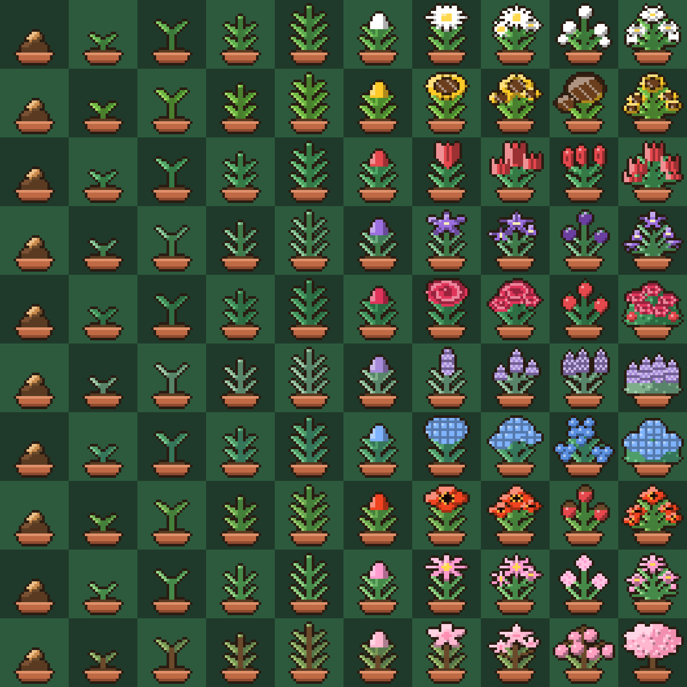

# Token Grove

<p align="center">
  <a href="README.md">English</a> · <b>한국어</b>
</p>

AI 코딩 도구를 쓴 만큼 도트 식물이 자라는 Windows 데스크톱 앱입니다.
평소처럼 Claude Code나 Codex를 쓰면 바탕화면 위 작은 화분이 알아서 자랍니다. 따로 누를 것은 없습니다.

<p align="center">
  
</p>

## 어떻게 동작하나요

- **펫 창**: 투명한 작은 창에 화분이 떠 있습니다. 끌어서 옮길 수 있고 다른 창 위에 항상 보입니다. 클릭하면 말을 걸어요. 우클릭하면 메뉴(정원 열기, 트레이로 숨기기, 시작 시 자동 실행, 종료)가 나오고, 트레이 아이콘으로 다시 불러올 수 있습니다.
- **정원 창**: 펫 창의 `정원` 버튼으로 엽니다. 현재 식물의 레벨과 경험치, 성장 기록, 완성한 식물 도감, 날씨와 연속 사용일, 업적, 설정을 볼 수 있습니다. `사진 저장`으로 정원 풍경을 PNG로 내보낼 수 있습니다.
- **성장**: Claude Code와 Codex가 남기는 로그에서 토큰 수만 읽어 경험치로 바꿉니다. 30초마다 새로 추가된 부분만 확인합니다.
- **완성**: 레벨 11에 도달하면 식물이 정원 도감에 보관되고, 새 씨앗이 무작위 종으로 시작됩니다.

### 성장 단계 (10단계)

씨앗 → 싹 → 새싹 → 어린 잎 → 무성한 잎 → 꽃봉오리 → 첫 꽃 → 만개 → 열매 → 큰 나무

레벨 1~10이 각각 한 단계이고, 한 개체가 완성되기까지 평소 사용량 기준 약 한 달을 목표로 잡았습니다.

### 식물 종 (10종)

데이지, 해바라기, 튤립, 도라지, 장미, 라벤더, 수국, 양귀비, 코스모스, 벚꽃.
씨앗 단계는 모든 종이 같아서 싹이 틀 때까지 무슨 종인지 알 수 없습니다.

### 경험치 계산

```
경험치 = (입력 토큰 + 출력 토큰 × 5) ÷ 30,000
```

- Claude Code의 입력 토큰은 `input_tokens + cache_creation_input_tokens`, Codex는 `input_tokens - cached_input_tokens` 입니다.
- 캐시를 다시 읽은 토큰(`cache_read_input_tokens`)은 세지 않습니다. 같은 문맥을 매번 다시 읽는 값이라 포함하면 사용량이 지나치게 부풀기 때문입니다.
- 같은 응답이 로그에 여러 줄로 기록되므로 `message.id`와 `requestId`로 중복을 제거합니다.
- 앱을 처음 실행하기 전에 쌓인 기록은 경험치로 반영하지 않습니다. 처음에는 현재 위치만 기억합니다.

변환 규칙은 [`src/shared/usage.ts`](src/shared/usage.ts)에 모여 있습니다.

## 개인정보

- 모든 처리는 내 PC 안에서만 이루어지며 외부로 전송하는 것이 없습니다.
- 로그에서는 기록 ID, 시각, 토큰 숫자만 꺼냅니다. 프롬프트나 대화 내용, 코드는 저장하지도 출력하지도 않습니다.
- 원본 로그(`~/.claude/projects/**/*.jsonl`, `~/.codex/sessions/**/*.jsonl`)는 읽기만 하고 수정하지 않습니다.
- 저장 파일은 `%APPDATA%\tokengrove\save.json` 하나뿐입니다.

## 다운로드

[Releases](https://github.com/oceanfromthewave/tokenGrove/releases/latest)에서 최신 `TokenGrove-Setup-<버전>.exe`를 받아 실행하세요.
코드 서명이 없어서 Windows SmartScreen이 경고할 수 있습니다. "추가 정보 → 실행"으로 진행하면 됩니다.

## 실행하기

요구 사항: Windows, Node.js 22 이상 (Node가 `.ts` 파일을 직접 실행하는 기능을 테스트에 사용합니다).

```powershell
npm install
npm run dev
```

설치 파일을 만들려면:

```powershell
npm run build:win      # dist\TokenGrove-Setup-<버전>.exe
```

### 개발 명령

| 명령 | 설명 |
|---|---|
| `npm run dev` | 개발 모드로 실행 |
| `npm run typecheck` | TypeScript 타입 검사 |
| `npm test` | 테스트 (Node 내장 테스트 러너) |
| `npm run preview:sprites` | 모든 종 × 단계 스프라이트를 PNG 한 장으로 렌더 |
| `npm run build:unpack` | 설치 없이 `dist\win-unpacked`로 패키징 |

## 구조

```
src/
├─ shared/     순수 로직. Electron에 의존하지 않고 테스트를 옆에 둔다.
│              growth(레벨·단계·종·완성), usage(기록 모델·경험치·중복 방지),
│              claudeCode·codex(로그 한 줄 변환), save(저장 파일 검증), sprites(도트 그림)
├─ main/       창 관리, 펫 상태의 단일 출처, 저장, 로그 증분 읽기
├─ preload/    렌더러에 노출하는 제한된 API
└─ renderer/   React 화면 (펫 창, 정원 창)
```

- 사용 기록 수집부와 게임 규칙을 분리했습니다. 다른 AI 도구를 추가하려면 로그를 공통 형식 `UsageRecord`로 바꾸는 변환부만 만들면 됩니다.
- 렌더러는 파일 시스템이나 Electron의 권한 있는 API를 직접 호출하지 않고, preload가 노출한 함수만 사용합니다.
- 도트 그림은 왼쪽 절반만 만들고 좌우로 복사해서 항상 대칭입니다.

## 현재 한계

- 지원하는 로그는 **Claude Code**와 **Codex**입니다. 다른 도구는 아직 연동하지 않았습니다.
- Windows에서만 확인했습니다.
- 경험치 환산 비율은 개발자 PC의 사용량으로 정한 값이라 사람에 따라 성장 속도가 다를 수 있습니다.

## 라이선스

[MIT](LICENSE)
